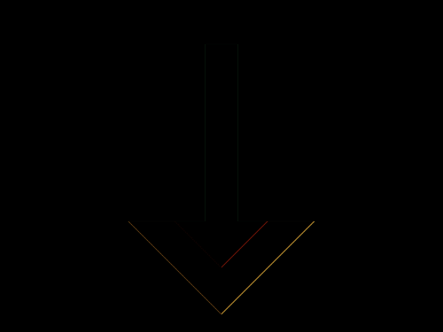

# Daily Target — Oct 11, 2026

Challenge: <https://cssbattle.dev/play/Fq5TIqZggu5mqVHldcND>

## Result

<table>
	<tr>
		<th width="50%">User Submission</th>
		<th width="50%">Target</th>
	</tr>
	<tr>
		<td width="50%" align="center">
			
		</td>
		<td width="50%" align="center">
			
		</td>
	</tr>
</table>

## Code

```html
<p a><p b><style>*{position:fixed;background:#FAE29E}p{background:#D16161}[a]{rotate:45deg;width:100;height:100;border:32q solid#3F4869;margin:83 112}[b]{width:30;height:160;border:solid#FAE29E;border-width:185 185 0;margin:-153-8
```
