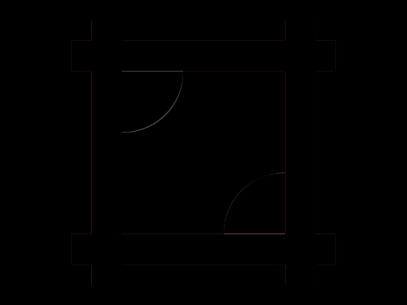
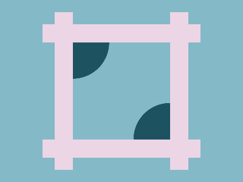

# Daily Target — Oct 12, 2026

Challenge: <https://cssbattle.dev/play/GtfVbDS2vn8CI4nnV4Yl>

## Result

<table>
	<tr>
		<th width="50%">User Submission</th>
		<th width="50%">Target</th>
	</tr>
	<tr>
		<td width="50%" align="center">
			
		</td>
		<td width="50%" align="center">
			
		</td>
	</tr>
</table>

## Code

```html
<p a><p a b><p c><p c d><style>*{background:#84B9C7}[a]{width:30;height:260;background:#ECD5E4;margin:20 82;box-shadow:201q 0#ECD5E4}[b]{rotate:90deg;margin:-375 177}[c]{width:60;height:60;background:#1D5260;margin:260 112;border-radius:0 0 5pc 0}[d]{rotate:180deg;margin:-220 212
```
