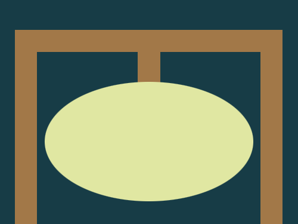
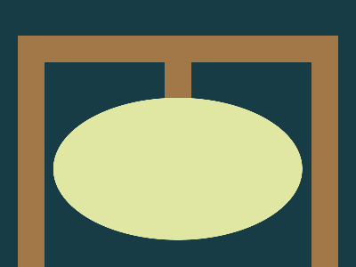

# Daily Target — Oct 13, 2026

Challenge: <https://cssbattle.dev/play/Hj6qgfMNxubgoTcYhOLe>

## Result

<table>
	<tr>
		<th width="50%">User Submission</th>
		<th width="50%">Target</th>
	</tr>
	<tr>
		<td width="50%" align="center">
			
		</td>
		<td width="50%" align="center">
			
		</td>
	</tr>
</table>

## Code

```html
<p a><p b><p c><style>*{background:#173C46}[a]{width:300;height:230;border:32q solid#A27848;margin:40 12}[b]{width:30;height:50;background:#A27848;margin:-300 177}[c]{width:280;height:160;background:#E0E7A2;margin:290 52;border-radius:50%
```
