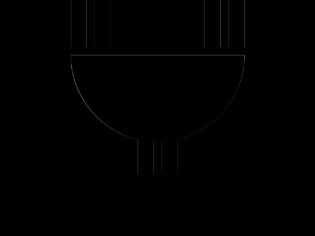
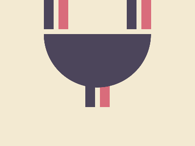

# Daily Target — Oct 16, 2026

Challenge: <https://cssbattle.dev/play/YPjOurDuyM7W6juGDTKS>

## Result

<table>
	<tr>
		<th width="50%">User Submission</th>
		<th width="50%">Target</th>
	</tr>
	<tr>
		<td width="50%" align="center">
			
		</td>
		<td width="50%" align="center">
			
		</td>
	</tr>
</table>

## Code

```html
<p a><p b><style>*{background:#F3EAD2}p{background:#4C455B}[a]{width:20;height:60;color:#4C455B;margin:-8 82;box-shadow:32q 0#D96C7B,90q 40vw,122q 40vw#D96C7B,180q 0,50vw 0#D96C7B}[b]{width:220;height:110;margin:18 82;border-radius:0 0 30vw 30vw
```
