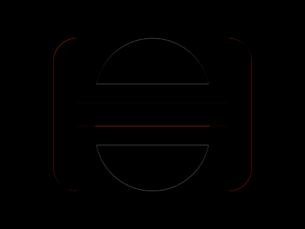

# Daily Target — Oct 18, 2026

Challenge: <https://cssbattle.dev/play/W7SWtIqYNFiLhipGj6bj>

## Result

<table>
	<tr>
		<th width="50%">User Submission</th>
		<th width="50%">Target</th>
	</tr>
	<tr>
		<td width="50%" align="center">
			
		</td>
		<td width="50%" align="center">
			
		</td>
	</tr>
</table>

## Code

```html
<p a><p b><p c><p d><style>*{background:#2D3464;width:150;height:200}[a]{width:260;background:#D95362;margin:50 62;border-radius:32q}[b]{width:200;height:90;margin:-255 92;box-shadow:0 30vw#2D3464}[c]{background:#C0D6E7;margin:170 117;border-radius:5pc}[d]{height:80;margin:-310 117;background:linear-gradient(#2D3464 0 25px,#D95362 25px 58q,#2D3464 0
```
