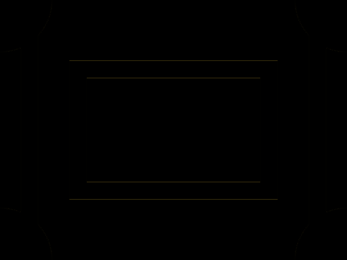

# Daily Target — Oct 19, 2026

Challenge: <https://cssbattle.dev/play/2pAGX40Ie74ziGcixMUI>

## Result

<table>
	<tr>
		<th width="50%">User Submission</th>
		<th width="50%">Target</th>
	</tr>
	<tr>
		<td width="50%" align="center">
			
		</td>
		<td width="50%" align="center">
			
		</td>
	</tr>
</table>

## Code

```html
<p a><p a b><p b c><style>*{background:#7E6293}[a]{width:312;height:300;margin:-28 16;border:5vw solid#E8BA79}[b]{width:200;height:120;margin:-250 72}[c]{width:120;border-radius:50%;background:#E8BA79;color:#E8BA79;margin:-290-68;box-shadow:25pc 0,0 75vw,25pc 75vw
```
