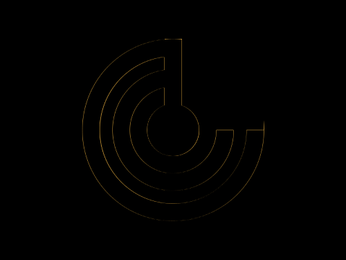

# Daily Target — Oct 21, 2026

Challenge: <https://cssbattle.dev/play/EvI5R1ccxSuBhrVqgIEr>

## Result

<table>
	<tr>
		<th width="50%">User Submission</th>
		<th width="50%">Target</th>
	</tr>
	<tr>
		<td width="50%" align="center">
			
		</td>
		<td width="50%" align="center">
			
		</td>
	</tr>
</table>

## Code

```html
<p a><p b><p c><style>*{background:#E9D97D}[a],[c]{width:60;height:60;border-radius:50%;background:#173C46}[a]{margin:120 162;box-shadow:0 0 0 5vw#E9D97D,0 0 0 5ch#173C46,0 0 0 58q#E9D97D,0 0 0 75px#173C46}[b]{width:95;height:105;border-left:5vw solid#173C46;margin:-255 182}[c]{margin:225 162
```
