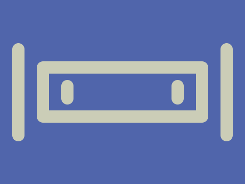

# Daily Target — Oct 24, 2026

Challenge: <https://cssbattle.dev/play/aX2gsaI5uRiBiKxXgfOp>

## Result

<table>
	<tr>
		<th width="50%">User Submission</th>
		<th width="50%">Target</th>
	</tr>
	<tr>
		<td width="50%" align="center">
			
		</td>
		<td width="50%" align="center">
			
		</td>
	</tr>
</table>

## Code

```html
<p a><p b><p b c><style>*{background:#5065AB}[a]{width:240;height:60;border:5vw solid#CBCDB7;margin:100 52;border-radius:11q}[b]{width:20;height:160;background:#CBCDB7;color:#CBCDB7;margin:-230 12;border-radius:5vw;box-shadow:85vw 0}[c]{height:40;margin:130 92;box-shadow:45vw 0
```
