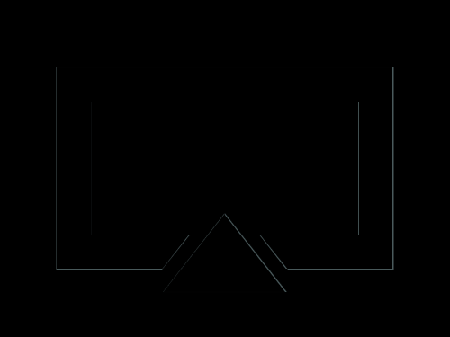

# Daily Target — Oct 25, 2026

Challenge: <https://cssbattle.dev/play/Y5ONBPIczkMuJt7MUtxP>

## Result

<table>
	<tr>
		<th width="50%">User Submission</th>
		<th width="50%">Target</th>
	</tr>
	<tr>
		<td width="50%" align="center">
			
		</td>
		<td width="50%" align="center">
			
		</td>
	</tr>
</table>

## Code

```html
<p a><p b><p c><style>&{background:#809E97}*{position:fixed}[b],[c]{border-left:55px solid#0000;border-right:55px solid#0000;border-bottom:70px solid#36443B}[a]{width:238;height:118;border:33q solid#36443B;margin:52 42}[b]{border-bottom:70px solid#809E97;scale:1.5;margin:178 137}[c]{margin:182 137
```
