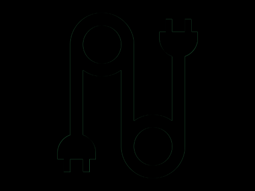
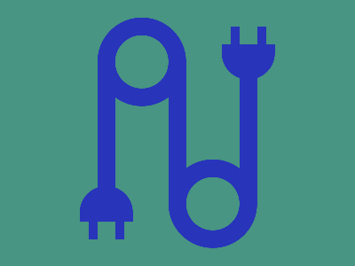

# Daily Target — Oct 26, 2026

Challenge: <https://cssbattle.dev/play/z0yxKNnAycnbUfSMzhrV>

## Result

<table>
	<tr>
		<th width="50%">User Submission</th>
		<th width="50%">Target</th>
	</tr>
	<tr>
		<td width="50%" align="center">
			
		</td>
		<td width="50%" align="center">
			
		</td>
	</tr>
</table>

## Code

```html
<p a><p a b><p c><p d><p d e><p f><style>*,[a]{background:#479582}p{background:#2834BA;color:#2834BA;width:60}[a]{height:60;border-radius:50%;border:5vw solid#2834BA;margin:20 102}[b]{margin:60 182}[c]{width:20;height:160;margin:-270 102;box-shadow:5pc 0,40vw 0}[d]{height:40;border-radius:5ch 5ch 0 0;margin:250 82}[e]{rotate:180deg;margin:-450 242}[f]{width:10;height:20;margin:610 92;box-shadow:32q 0,40vw -55vw,201q -55vw
```
