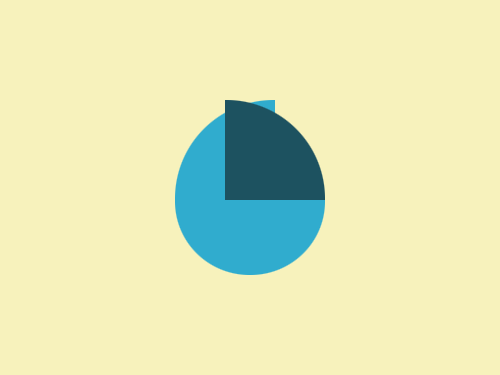

# Daily Target — Oct 28, 2026

Challenge: <https://cssbattle.dev/play/qeaTGocAQsBBgTBIEDEn>

## Result

<table>
	<tr>
		<th width="50%">User Submission</th>
		<th width="50%">Target</th>
	</tr>
	<tr>
		<td width="50%" align="center">
			
		</td>
		<td width="50%" align="center">
			
		</td>
	</tr>
</table>

## Code

```html
<p><p a><p a b><style>*{background:#F7F2BC}p{background:#30ACCE;width:120;height:60;border-radius:0 0 63q 63q;margin:160 132}[a]{width:80;height:80;margin:-300 132;border-radius:5pc 0 0}[b]{background:#1D5260;border-radius:0 5pc 0 0;margin:220 172
```
