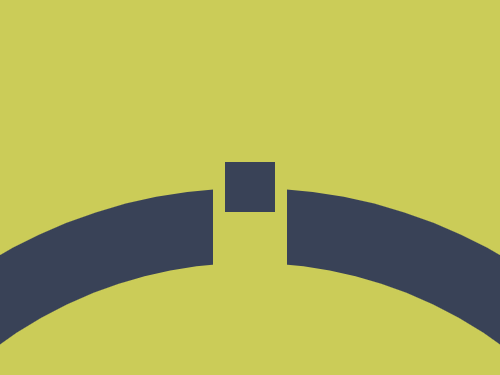

# Daily Target — Oct 30, 2026

Challenge: <https://cssbattle.dev/play/7320ZxyvTU6UikVfB8kl>

## Result

<table>
	<tr>
		<th width="50%">User Submission</th>
		<th width="50%">Target</th>
	</tr>
	<tr>
		<td width="50%" align="center">
			
		</td>
		<td width="50%" align="center">
			
		</td>
	</tr>
</table>

## Code

```html
<p a><p b><style>*{background:#CBCC58}[a]{width:680;height:340;border:64q solid#394257;border-radius:50pc 50pc 0 0;margin:150-208}[b]{width:40;height:40;background:#394257;border:solid#CBCC58;border-width:50 10;margin:-680 162
```
