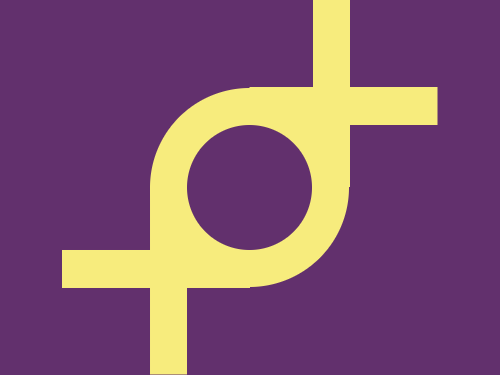

# Daily Target — Oct 31, 2026

Challenge: <https://cssbattle.dev/play/TWNhOfMsYQnVbyjKPFeG>

## Result

<table>
	<tr>
		<th width="50%">User Submission</th>
		<th width="50%">Target</th>
	</tr>
	<tr>
		<td width="50%" align="center">
			
		</td>
		<td width="50%" align="center">
			
		</td>
	</tr>
</table>

## Code

```html
<p a><p b><p b c><style>*{background:#62306D}[a]{width:100;height:100;border-radius:50%;border:32q solid#F7EC7D;margin:70 112}[b]{width:30;height:150;background:#F7EC7D;color:#F7EC7D;margin:-300 242;box-shadow:-138q 50vh}[c]{rotate:90deg;margin:160 252;box-shadow:138q 50vh
```
