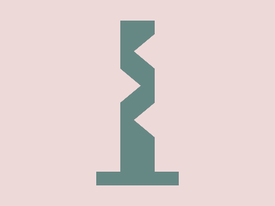

# Daily Target — Nov 3, 2026

Challenge: <https://cssbattle.dev/play/uUqcv42UqXa4qqYW40dd>

## Result

<table>
	<tr>
		<th width="50%">User Submission</th>
		<th width="50%">Target</th>
	</tr>
	<tr>
		<td width="50%" align="center">
			
		</td>
		<td width="50%" align="center">
			
		</td>
	</tr>
</table>

## Code

```html
<p a><p a b><p c><p d><p c e><style>&{background:#EED9D9}[a]{width:50;height:220;background:#668884;margin:30 167}[b]{width:120;height:20;margin:-30 132}[c],[d]{border-top:27q solid#0000;border-bottom:27q solid#0000}[c]{border-right:32q solid#EED9D9;margin:-220 187}[d]{border-left:32q solid#EED9D9;margin:220 167}[e]{margin:-220 187
```
