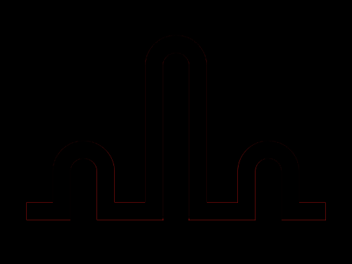
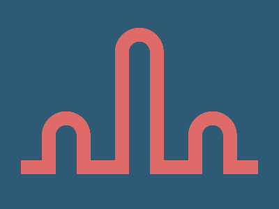

# Daily Target — Nov 4, 2026

Challenge: <https://cssbattle.dev/play/RbDuoqqerMZQNioN9XHm>

## Result

<table>
	<tr>
		<th width="50%">User Submission</th>
		<th width="50%">Target</th>
	</tr>
	<tr>
		<td width="50%" align="center">
			
		</td>
		<td width="50%" align="center">
			
		</td>
	</tr>
</table>

## Code

```html
<p a><p b><p b c><p b d><p><style>*{background:#2F5A76}[a]{height:20;background:#DE6B67;margin:230 22}[b]{width:30;height:200;border:5vw solid#DE6B67;margin:-440 157;border-radius:5ch}[c]{margin:320 52}[d]{margin:-560 262}p{width:340;height:60;margin:410 22
```
