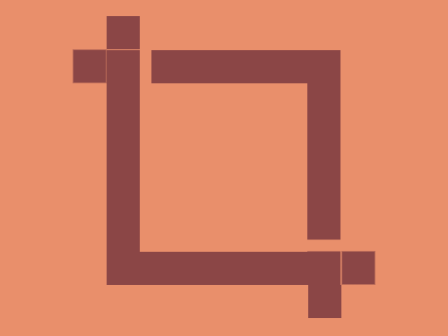

# Daily Target — Nov 6, 2026

Challenge: <https://cssbattle.dev/play/jHTSQXbsHDY0OOetADF1>

## Result

<table>
	<tr>
		<th width="50%">User Submission</th>
		<th width="50%">Target</th>
	</tr>
	<tr>
		<td width="50%" align="center">
			
		</td>
		<td width="50%" align="center">
			
		</td>
	</tr>
</table>

## Code

```html
<p a><p b><p><p c><style>*{background:#E98F6B}[a]{width:150;height:150;border:32q solid#8B4646;margin:45 87}[b]{width:30;background:#8B4646;color:8B4646;margin:-285 87;box-shadow:-30px 30px,45vw 60vw,70vh 70vh}p{width:10;height:30;margin:285 117}[c]{rotate:90deg;margin:-155 277
```
