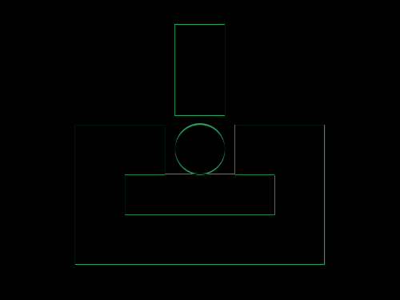
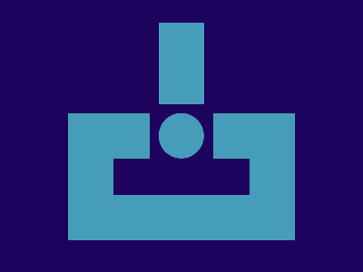

# Daily Target — Nov 9, 2026

Challenge: <https://cssbattle.dev/play/V3rcPynSdxNerqyJeVdL>

## Result

<table>
	<tr>
		<th width="50%">User Submission</th>
		<th width="50%">Target</th>
	</tr>
	<tr>
		<td width="50%" align="center">
			
		</td>
		<td width="50%" align="center">
			
		</td>
	</tr>
</table>

## Code

```html
<p a><p b><p c><style>*{background:#1D025E;width:50}[a]{width:150;height:40;border:53q solid#469DBA;margin:125 67}[c]{height:50;border-radius:50%;background:#469DBA;margin:325 167}[b]{height:140;border:11q solid#1D025E;margin:-375 157;background:linear-gradient(#469DBA 0 5lh,#1D025E 0
```
