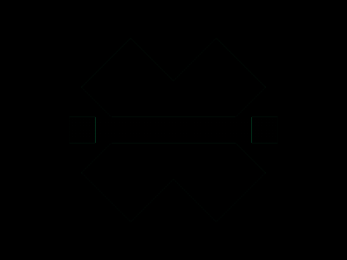
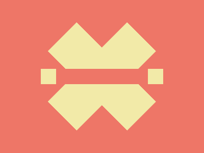

# Daily Target — Nov 12, 2026

Challenge: <https://cssbattle.dev/play/odhXZQ3ZrxdqUAYnc3D5>

## Result

<table>
	<tr>
		<th width="50%">User Submission</th>
		<th width="50%">Target</th>
	</tr>
	<tr>
		<td width="50%" align="center">
			
		</td>
		<td width="50%" align="center">
			
		</td>
	</tr>
</table>

## Code

```html
<p a><p a b><p><style>*{position:fixed;background:#EE7667}[a]{width:80;height:220;background:#F2EAA8;rotate:45deg;margin:32 152}[b]{rotate:-45deg;margin:32 152}p{width:240;height:30;margin:127 72;background:linear-gradient(to right,#F2EAA8 0 32q,#EE7667 32q 70vh,#F2EAA8 0
```
