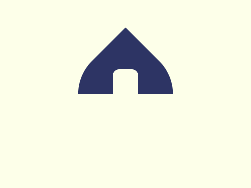
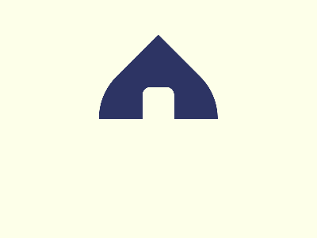

# Daily Target — Nov 15, 2026

Challenge: <https://cssbattle.dev/play/remxMOJe0OJmVRBlgKqm>

## Result

<table>
	<tr>
		<th width="50%">User Submission</th>
		<th width="50%">Target</th>
	</tr>
	<tr>
		<td width="50%" align="center">
			
		</td>
		<td width="50%" align="center">
			
		</td>
	</tr>
</table>

## Code

```html
<p a><p><p b><style>*{position:fixed;background:#FDFFE9}[a]{background:#2D3464;rotate:-45deg;border-radius:79q 0;margin:67 117}p{width:150;height:150;margin:142 117}[b]{width:40;height:80;border-radius:11q;margin:102 172
```
