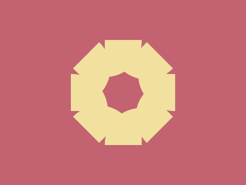
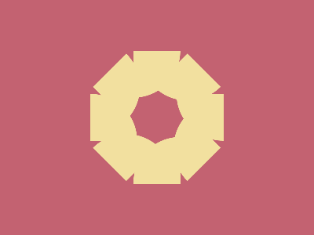

# Daily Target — Nov 16, 2026

Challenge: <https://cssbattle.dev/play/jnMuDO3lQ6zvVd2hlovm>

## Result

<table>
	<tr>
		<th width="50%">User Submission</th>
		<th width="50%">Target</th>
	</tr>
	<tr>
		<td width="50%" align="center">
			
		</td>
		<td width="50%" align="center">
			
		</td>
	</tr>
</table>

## Code

```html
<p><p a><p b><p c><p d><p e><p f><p g><style>*{background:#C36271}p{width:60;height:60;background:#F2E09F;border-radius:0 0 5pc;margin:65 162}[a]{rotate:45deg;margin:-109 201}[b]{rotate:90deg;margin:88 217}[c]{rotate:135deg;margin:-109 201}[d]{rotate:180deg;margin:65 162}[e]{rotate:225deg;margin:-141 123}[f]{rotate:270deg;margin:42 107}[g]{rotate:315deg;margin:-141 123
```
