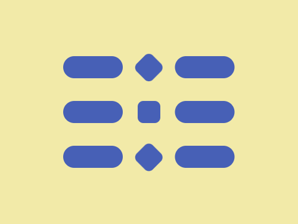
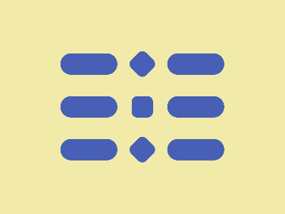

# Daily Target — Nov 18, 2026

Challenge: <https://cssbattle.dev/play/OuZGRWZ169z3th35sN48>

## Result

<table>
	<tr>
		<th width="50%">User Submission</th>
		<th width="50%">Target</th>
	</tr>
	<tr>
		<td width="50%" align="center">
			
		</td>
		<td width="50%" align="center">
			
		</td>
	</tr>
</table>

## Code

```html
<p a><p><p b><style>*{background:#F2EAA8}[a]{width:80;margin:75 77;border-radius:5vw;box-shadow:50vh 0,0 60px,50vh 60px,0 30vw,50vh 30vw}p{background:#4760B6;color:4760B6;border-radius:8q;width:30;height:30;margin:-45 177}[b]{rotate:45deg;margin:-90 177;box-shadow:90q 90q
```
