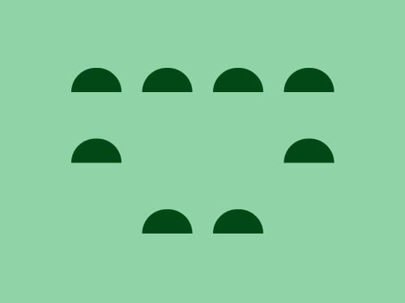

# Daily Target — Nov 21, 2026

Challenge: <https://cssbattle.dev/play/uzoOpbBnY8iXVAKpjzxS>

## Result

<table>
	<tr>
		<th width="50%">User Submission</th>
		<th width="50%">Target</th>
	</tr>
	<tr>
		<td width="50%" align="center">
			
		</td>
		<td width="50%" align="center">
			
		</td>
	</tr>
</table>

## Code

```html
<p>
<style>
  *{
    background:#90D3A6;
  }
  p{
    width:50;
    height:24;
    background:#024817;
    color:#024817;
    border-radius:30px 30px 0 0;
    margin:67.5 62;
    box-shadow:70px 0,140px 0,210px 0,0 70px,210px 70px,70px 140px,140px 140px;
  }
</style>
```
